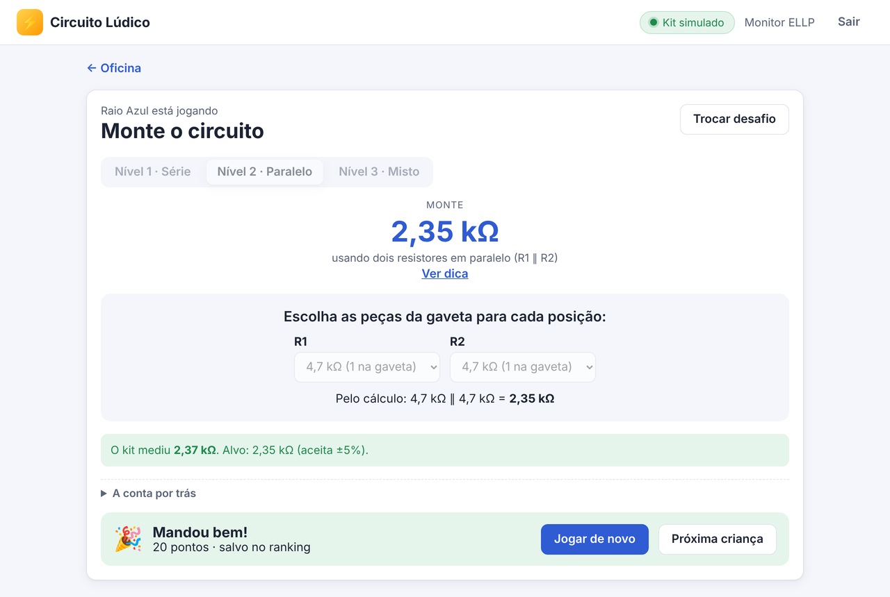

# ⚡ Circuito Lúdico

Kit de lógica e circuitos elétricos com Arduino + plataforma web, desenvolvido para as oficinas do
projeto de extensão **ELLP – Ensino Lúdico de Lógica e Programação** da UTFPR Câmpus Cornélio Procópio.

Disciplina EC46H – Certificadora da Competência 2 (2026/2) · Prof. Fábio Fernandes da Rocha Vicente
Autor: Guilherme Baldo Gonçalves (RA 2564165)



## O que faz

Três desafios com correção automática para crianças de 10 a 16 anos:

| Desafio | Conteúdo | Como o kit confere |
| --- | --- | --- |
| **Genius de cores** | sequência, memória, algoritmo | máquina de estados + vetor sorteado; 4 botões em um único pino analógico |
| **Qual é o resistor?** | código de cores, Lei de Ohm | ohmímetro por divisor de tensão + busca binária na série E12 |
| **Monte o circuito** | associação série, paralelo e mista | mede a resistência equivalente e aceita ±5% |

O monitor cadastra a oficina e as crianças (só apelido, LGPD), acompanha o ranking ao vivo e baixa o
relatório em CSV. Sem o hardware, a plataforma usa um **kit simulado** que roda a mesma lógica do firmware.

## Arquitetura

```
Navegador (React)  ──USB / Web Serial──  Arduino Uno (firmware C++)
      │                                    LEDs · buzzer · escada de botões (A0) · ohmímetro (A1)
      │ HTTP/JSON
      ▼
API Node.js (http nativo)  ──  SQLite (node:sqlite)
```

- `firmware/` – código do Arduino (sem bibliotecas externas, roda também no Tinkercad Circuits)
- `api/` – backend em Node.js puro: rotas → controladores → serviços → repositórios → SQLite
- `web/` – frontend React; `web/dist/` já vem compilado
- `hardware/` – memória de cálculo e script `calculos.py`
- `docs/` – manual de montagem, roteiro de oficina e capturas de tela

## Tecnologias

| Camada | Tecnologia |
| --- | --- |
| Firmware | C++ (Arduino IDE), protocolo JSON por linha a 115200 baud |
| Backend | Node.js ≥ 22.13, módulos nativos `http`, `crypto` e `node:sqlite` (zero dependências) |
| Banco | SQLite (arquivo `api/data/circuito-ludico.db`, criado na primeira execução) |
| Frontend | React 19, Web Serial API, empacotado com esbuild |
| Testes | `node:test` (API e algoritmos) |

## Instalação e execução

Pré-requisito: **Node.js 22.13 ou mais novo** ([nodejs.org](https://nodejs.org)). Para o kit real,
Chrome ou Edge no computador.

```bash
git clone https://github.com/<seu-usuario>/circuito-ludico.git
cd circuito-ludico/api
npm start
```

Abra **http://localhost:3000** no Chrome. A API não tem dependências: não precisa de `npm install`.

### Dados de acesso (demonstração)

- E-mail: `monitor@ellp.utfpr`
- Senha: `ellp2026`

### Exemplo de uso

1. Entre com o login acima e crie uma oficina (data, local, turma).
2. Cadastre as crianças pelo apelido e a faixa etária.
3. Clique no indicador "Kit desconectado" (canto superior) e escolha **Kit pela USB** ou **Kit simulado**.
4. Em **Começar desafios**, escolha quem vai jogar e o desafio.
5. Acompanhe o **Ranking** e baixe o **Relatório** em CSV ao final.

### Gravar o firmware

1. Monte o circuito seguindo `docs/manual-de-montagem.md`.
2. Abra `firmware/circuito_ludico/circuito_ludico.ino` no Arduino IDE, placa "Arduino Uno", e carregue.
3. Para simular sem hardware: crie um circuito no Tinkercad Circuits com as mesmas ligações e cole o código.

### Alterar o frontend

```bash
cd web
npm install        # react, react-dom e esbuild
npm run build      # gera web/dist (servido pela API)
npm run dev        # recompila a cada alteração
```

### Testes

```bash
cd api && npm test      # rotas, login, ranking, relatório, merge sort
cd web && npm test      # escada de botões, ohmímetro, busca E12, código de cores, associações
python3 hardware/calculos.py
```

## API REST

| Método | Rota | Descrição |
| --- | --- | --- |
| POST | `/api/auth/login` | login do monitor → token |
| GET / POST | `/api/oficinas` | listar / criar oficinas |
| GET | `/api/oficinas/:id` | detalhes da oficina |
| GET / POST | `/api/oficinas/:id/participantes` | listar / cadastrar apelidos |
| DELETE | `/api/participantes/:id` | remover participante |
| GET | `/api/desafios` | lista dos desafios |
| POST | `/api/tentativas` | registrar resultado de um desafio |
| GET | `/api/oficinas/:id/ranking` | ranking (merge sort: pontos, acertos, tentativas) |
| GET | `/api/oficinas/:id/relatorio[?formato=csv]` | relatório por desafio / CSV |

Todas as rotas, menos o login, exigem `Authorization: Bearer <token>`.

## Modelo de dados

`monitor (id, nome, email, senha_hash)` 1—N `oficina (id, data, local, turma, monitor_id)`
1—N `participante (id, apelido, faixa_etaria, oficina_id)` 1—N
`tentativa (id, participante_id, desafio_id, nivel, pontos, acertou, duracao_ms, valor_medido, criado_em)`
N—1 `desafio (id, tipo, nome, descricao)`.

## Licença

MIT.
